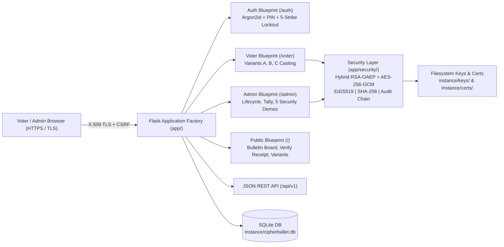
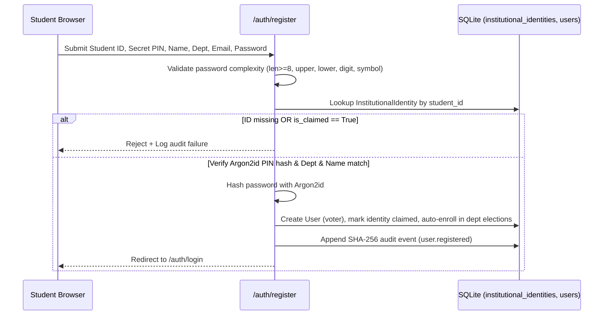
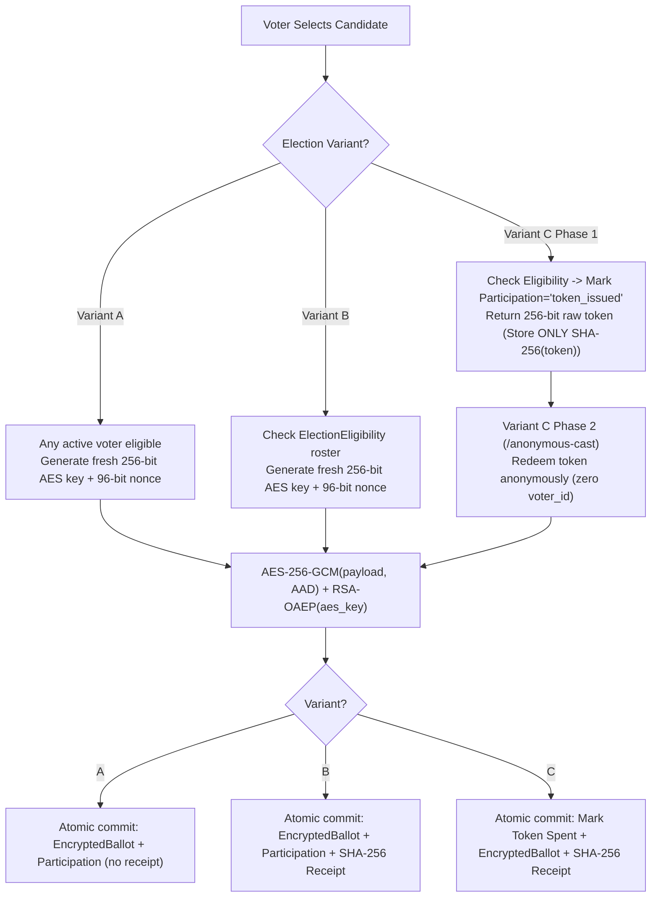

# 03. System Architecture, Data-Flow Diagrams, Database Design & API Inventory

## 1. High-Level System Architecture

---

## 2. Cryptographic Data-Flow Diagrams

### 2.1 Student Registration with Criteria & Secret PIN Verification

### 2.2 Hybrid Ballot Encryption Flow (Variants A & B) vs. Variant C Token Flow

---

## 3. Relational Database Design (`app/models.py`)

All 11 tables and their privacy isolation boundaries:

1. **`users`**: `id`, `username` (unique), `display_name`, `password_hash` (Argon2id), `role` (`admin` / `voter`), `student_id`, `department`, `id_verified`, `is_active`, `failed_login_attempts`, `locked_until`, `created_at`.
2. **`institutional_identities`**: `id`, `student_id` (unique), `full_name`, `department`, `email` (unique), `verification_pin_hash` (Argon2id), `is_claimed`, `claimed_at`, `claimed_by_user_id`.
3. **`elections`**: `id`, `title`, `description`, `group_dept`, `start_dt`, `end_dt`, `status` (`draft`, `open`, `closed`, `published`), `variant` (`A`, `B`, `C`), `created_by`.
4. **`candidates`**: `id`, `election_id` (FK), `display_name`, `description`, `is_active`, `display_order`.
5. **`election_eligibilities`**: `id`, `election_id`, `voter_id`, `status` (`eligible`, `ineligible`), `UNIQUE(election_id, voter_id)`.
6. **`participations`**: `id`, `election_id`, `voter_id`, `cast_at`, `status` (`voted`, `token_issued`), `UNIQUE(election_id, voter_id)`. **Contains NO `candidate_id` and NO `ballot_id`.**
7. **`anonymous_tokens`** *(Variant C)*: `id`, `election_id`, `token_hash` (SHA-256, unique), `is_spent`, `issued_at`, `spent_at`. **Contains NO `voter_id`.**
8. **`encrypted_ballots`**: `id` (UUID), `election_id`, `nonce_hex`, `ciphertext_hex`, `tag_hex`, `aad_hex`, `wrapped_key_hex` (RSA-OAEP), `algorithm` (`RSA-OAEP+AES-256-GCM`), `version`, `created_at`. **Contains NO `voter_id` and NO plaintext `candidate_id`.**
9. **`receipts`**: `id`, `receipt_code` (256-bit URL-safe token), `election_id`, `ballot_id`, `ballot_digest_hex` (SHA-256), `created_at`. **Contains NO `voter_id`.**
10. **`audit_events`**: `id`, `event_type`, `actor_category`, `actor_ref`, `safe_payload`, `prev_hash`, `event_hash` (`SHA-256(prev_hash || canonical_json(payload))`), `created_at`.
11. **`published_results`**: `id`, `election_id` (unique), `result_json`, `signature_hex` (Ed25519), `public_key_id`, `published_at`.

---

## 4. Application Routes & REST API List

### Authentication (`/auth`)
- `GET/POST /auth/login` — Argon2id login, IP rate limiting, 5-strike temporary lockout
- `GET/POST /auth/register` — Student ID + Secret PIN + Department criteria verification
- `POST /auth/logout` — CSRF-protected session logout

### Public & Transparency (`/`)
- `GET /` — Public overview, open polls, certified results
- `GET /bulletin-board` & `/bulletin-board/<id>` — Anonymized receipt digests
- `GET/POST /verify-receipt` — Public SHA-256 receipt verifier
- `GET/POST /anonymous-cast/<id>` — Variant C unauthenticated anonymous ballot box
- `GET /results/<id>` — Certified results with live Ed25519 signature verification
- `GET /variants` — Side-by-side comparison of Variants A, B, and C
- `GET /privacy` — Security & privacy architecture guide
- `GET /health` — JSON health status check

### Voter (`/voter`)
- `GET /voter/` — Personalized voter dashboard
- `GET /voter/elections` & `/voter/elections/<id>` — Election catalog & cryptographic specs
- `GET/POST /voter/elections/<id>/vote` — Variant A/B casting or Variant C Phase 1/2 token workflow
- `GET /voter/receipt/<receipt_code>` — Printable verifiable receipt
- `GET /voter/status` — Participation records

### Admin (`/admin`)
- `GET /admin/` — Election administration dashboard
- `GET/POST /admin/elections`, `/new`, `/<id>/edit`, `/<id>/status` — Lifecycle management
- `GET/POST /admin/elections/<id>/eligibility` — Individual eligibility roster management
- `GET/POST /admin/elections/<id>/tally` — Hybrid RSA+AES-GCM decryption & Ed25519 signing
- `GET /admin/users`, `POST /admin/registry/add`, `POST /admin/users/<id>/unlock` — User, Lockout & Institutional Registry control
- `GET /admin/audit`, `POST /admin/audit/verify` — Hash-chained audit log inspector
- `GET /admin/security-demo`, `POST /admin/security-demo/run` — Executes all 5 controlled security experiments

### REST API (`/api/v1`)
- `GET /api/v1/elections/` — Public list of open/published elections
- `GET /api/v1/elections/<id>/results` — JSON signed results + Ed25519 validity status
